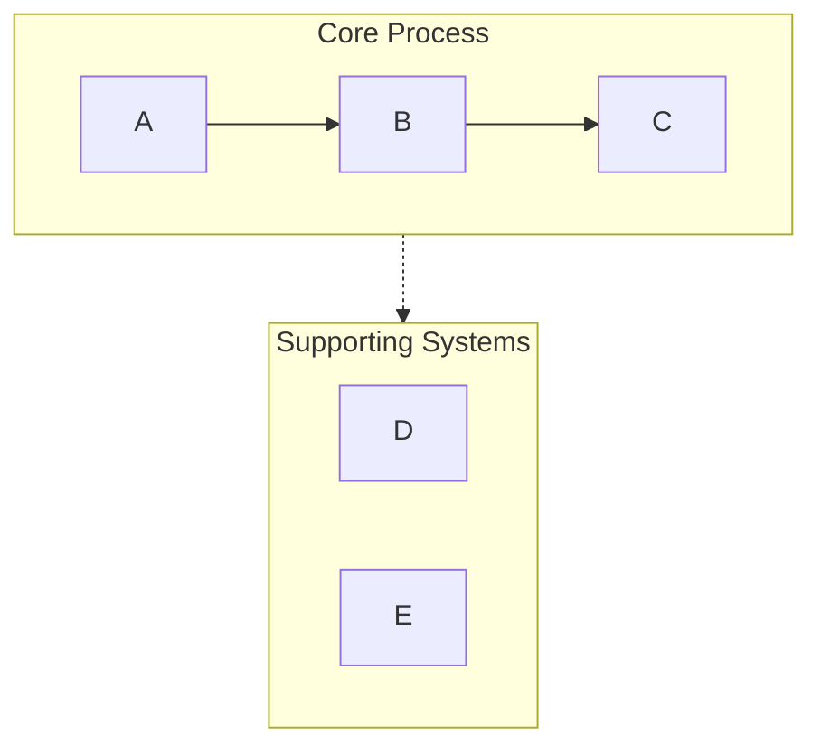
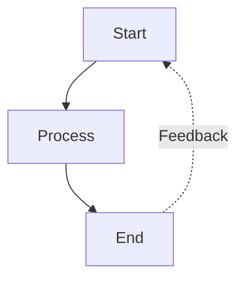
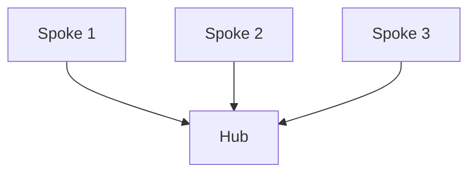
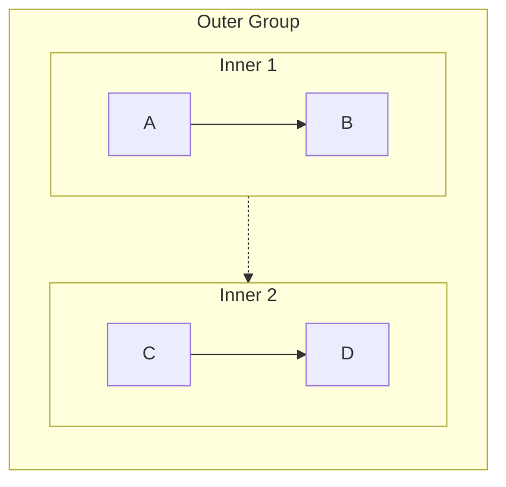
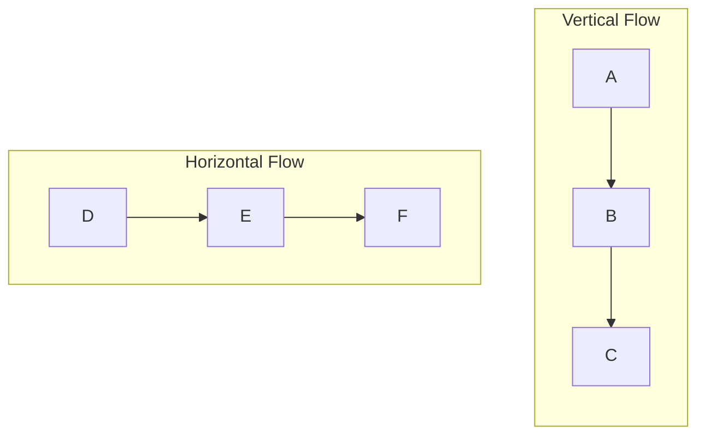

> **本文件是技能 `obsidian` 的参考资料 · Mermaid 可视化。** 按需读取；文中相对路径（`assets/...`、`references/...`）都相对于技能根目录 `~/.agents/skills/obsidian/`。 本文件结构：正文（图表类型、避坑规则、配色）+ 附录 语法规则。

# Mermaid Visualizer

## Overview

Convert text content into clean, professional Mermaid diagrams optimized for presentations and documentation. Automatically handles common syntax pitfalls (list syntax conflicts, subgraph naming, spacing issues) to ensure diagrams render correctly in Obsidian, GitHub, and other Mermaid-compatible platforms.

## Quick Start

When creating a Mermaid diagram:

1. **Analyze the content** - Identify key concepts, relationships, and flow
2. **Choose diagram type** - Select the most appropriate visualization (see Diagram Types below)
3. **Select configuration** - Determine layout, detail level, and styling
4. **Generate diagram** - Create syntactically correct Mermaid code
5. **Output in markdown** - Wrap in proper code fence with optional explanation

**Default assumptions:**
- Vertical layout (TB) unless horizontal requested
- Medium detail level (balanced between simplicity and information)
- Professional color scheme with semantic colors
- Obsidian/GitHub compatible syntax

## Diagram Types

### 1. Process Flow (graph TB/LR)
**Best for:** Workflows, decision trees, sequential processes, AI agent architectures

**Use when:** Content describes steps, stages, or a sequence of actions

**Key features:**
- Swimlanes via subgraph for grouping related steps
- Arrow labels for transitions
- Feedback loops and branches
- Color-coded stages

**Configuration options:**
- `layout`: "vertical" (TB), "horizontal" (LR)
- `detail`: "simple" (core steps only), "standard" (with descriptions), "detailed" (with annotations)
- `style`: "minimal", "professional", "colorful"

### 2. Circular Flow (graph TD with circular layout)
**Best for:** Cyclic processes, continuous improvement loops, agent feedback systems

**Use when:** Content emphasizes iteration, feedback, or circular relationships

**Key features:**
- Central hub with radiating elements
- Curved feedback arrows
- Clear cycle indicators

### 3. Comparison Diagram (graph TB with parallel paths)
**Best for:** Before/after comparisons, A vs B analysis, traditional vs modern systems

**Use when:** Content contrasts two or more approaches or systems

**Key features:**
- Side-by-side layout
- Central comparison node
- Clear differentiation via color/style

### 4. Mindmap
**Best for:** Hierarchical concepts, knowledge organization, topic breakdowns

**Use when:** Content is hierarchical with clear parent-child relationships

**Key features:**
- Radial tree structure
- Multiple levels of nesting
- Clean visual hierarchy

### 5. Sequence Diagram
**Best for:** Interactions between components, API calls, message flows

**Use when:** Content involves communication between actors/systems over time

**Key features:**
- Timeline-based layout
- Clear actor separation
- Activation boxes for processes

### 6. State Diagram
**Best for:** System states, status transitions, lifecycle stages

**Use when:** Content describes states and transitions between them

**Key features:**
- Clear state nodes
- Labeled transitions
- Start and end states

## Critical Syntax Rules

**Always follow these rules to prevent parsing errors:**

### Rule 1: Avoid List Syntax Conflicts
```
❌ WRONG: [1. Perception]       → Triggers "Unsupported markdown: list"
✅ RIGHT: [1.Perception]         → Remove space after period
✅ RIGHT: [① Perception]         → Use circled numbers (①②③④⑤⑥⑦⑧⑨⑩)
✅ RIGHT: [(1) Perception]       → Use parentheses
✅ RIGHT: [Step 1: Perception]   → Use "Step" prefix
```

### Rule 2: Subgraph Naming
```
❌ WRONG: subgraph AI Agent Core  → Space in name without quotes
✅ RIGHT: subgraph agent["AI Agent Core"]  → Use ID with display name
✅ RIGHT: subgraph agent          → Use simple ID only
```

### Rule 3: Node References
```
❌ WRONG: Title --> AI Agent Core  → Reference display name directly
✅ RIGHT: Title --> agent          → Reference subgraph ID
```

### Rule 4: Special Characters in Node Text
```
✅ Use quotes for text with spaces: ["Text with spaces"]
✅ Escape or avoid: quotation marks → use 『』instead
✅ Escape or avoid: parentheses → use 「」instead
✅ Line breaks in circle nodes only: ((Text<br/>Break))
```

### Rule 5: Arrow Types
- `-->` solid arrow
- `-.->` dashed arrow (for supporting systems, optional paths)
- `==>` thick arrow (for emphasis)
- `~~~` invisible link (for layout only)

For complete syntax reference and edge cases, see 本文件末的附录（Mermaid 语法规则）

## Configuration Options

All diagrams accept these parameters:

**Layout:**
- `direction`: "vertical" (TB), "horizontal" (LR), "right-to-left" (RL), "bottom-to-top" (BT)
- `aspect`: "portrait" (default), "landscape" (wide), "square"

**Detail Level:**
- `simple`: Core elements only, minimal labels
- `standard`: Balanced detail with key descriptions (default)
- `detailed`: Full annotations, explanations, and metadata
- `presentation`: Optimized for slides (larger text, fewer details)

**Style:**
- `minimal`: Monochrome, clean lines
- `professional`: Semantic colors, clear hierarchy (default)
- `colorful`: Vibrant colors, high contrast
- `academic`: Formal styling for papers/documentation

**Additional Options:**
- `show_legend`: true/false - Include color/symbol legend
- `numbered`: true/false - Add sequence numbers to steps
- `title`: string - Add diagram title

## Example Usage Patterns

**Pattern 1: Basic request**
```
User: "Visualize the software development lifecycle"
Response: [Analyze → Choose graph TB → Generate with standard detail]
```

**Pattern 2: With configuration**
```
User: "Create a horizontal flowchart of our sales process with lots of detail"
Response: [Analyze → Choose graph LR → Generate with detailed level]
```

**Pattern 3: Comparison**
```
User: "Compare traditional AI vs AI agents"
Response: [Analyze → Choose comparison layout → Generate with contrasting styles]
```

## Workflow

1. **Understand the content**
   - Identify main concepts, entities, and relationships
   - Determine hierarchy or sequence
   - Note any comparisons or contrasts

2. **Select diagram type**
   - Match content structure to diagram type
   - Consider user's presentation context
   - Default to process flow if ambiguous

3. **Choose configuration**
   - Apply user-specified options
   - Use sensible defaults for unspecified options
   - Optimize for readability

4. **Generate Mermaid code**
   - Follow all syntax rules strictly
   - Use semantic naming (descriptive IDs)
   - Apply consistent styling
   - Test for common errors:
     * No "number. space" patterns in node text
     * All subgraphs use ID["display name"] format
     * All node references use IDs not display names

5. **Output with context**
   - Wrap in ```mermaid code fence
   - Add brief explanation of diagram structure
   - Mention rendering compatibility (Obsidian, GitHub, etc.)
   - Offer to adjust or create variations

## Color Scheme Defaults

Standard professional palette:
- Green (#d3f9d8/#2f9e44): Input, perception, start states
- Red (#ffe3e3/#c92a2a): Planning, decision points
- Purple (#e5dbff/#5f3dc4): Processing, reasoning
- Orange (#ffe8cc/#d9480f): Actions, tool usage
- Cyan (#c5f6fa/#0c8599): Output, execution, results
- Yellow (#fff4e6/#e67700): Storage, memory, data
- Pink (#f3d9fa/#862e9c): Learning, optimization
- Blue (#e7f5ff/#1971c2): Metadata, definitions, titles
- Gray (#f8f9fa/#868e96): Neutral elements, traditional systems

## Common Patterns

### Swimlane Pattern (Grouping)


### Feedback Loop Pattern


### Hub and Spoke Pattern


## Quality Checklist

Before outputting, verify:
- [ ] No "number. space" patterns in any node text
- [ ] All subgraphs use proper ID syntax
- [ ] All arrows use correct syntax (-->, -.->)
- [ ] Colors applied consistently
- [ ] Layout direction specified
- [ ] Style declarations present
- [ ] No ambiguous node references
- [ ] Compatible with Obsidian/GitHub renderers
- [ ] **No Emoji** in any node text - use text labels or color coding instead

## References

For detailed syntax rules and troubleshooting, see the appendix in this file:
- 附录 · Mermaid 语法规则（Syntax Rules）— complete syntax reference and error prevention


---

## 附录 · Mermaid 语法规则（Syntax Rules）

# Mermaid Syntax Rules Reference

This reference provides comprehensive syntax rules and error prevention strategies for Mermaid diagrams. Load this when encountering syntax errors or needing detailed syntax information.

## Table of Contents

1. [Critical Error Prevention](#critical-error-prevention)
2. [Node Syntax](#node-syntax)
3. [Subgraph Syntax](#subgraph-syntax)
4. [Arrow and Connection Types](#arrow-and-connection-types)
5. [Styling and Colors](#styling-and-colors)
6. [Layout and Direction](#layout-and-direction)
7. [Advanced Patterns](#advanced-patterns)
8. [Troubleshooting](#troubleshooting)

## Critical Error Prevention

### List Syntax Conflict (Most Common Error)

**Problem:** Mermaid parser interprets `number. space` as Markdown ordered list syntax.

**Error Message:** `Parse error: Unsupported markdown: list`

**Solutions:**

```mermaid
❌ [1. Perception]
❌ [2. Planning]
❌ [3. Reasoning]

✅ [1.Perception]           # Remove space
✅ [① Perception]           # Use circled numbers
✅ [(1) Perception]         # Use parentheses  
✅ [Step 1: Perception]     # Use prefix
✅ [Step 1 - Perception]    # Use dash
✅ [Perception]             # Remove numbering
```

**Circled number reference:**
```
① ② ③ ④ ⑤ ⑥ ⑦ ⑧ ⑨ ⑩ ⑪ ⑫ ⑬ ⑭ ⑮ ⑯ ⑰ ⑱ ⑲ ⑳
```

### Subgraph Naming Rules

**Rule:** Subgraphs with spaces must use ID + display name format.

```mermaid
❌ subgraph Core Process
     A --> B
   end

✅ subgraph core["Core Process"]
     A --> B
   end

✅ subgraph core_process
     A --> B
   end
```

**Referencing subgraphs:**
```mermaid
❌ Title --> Core Process      # Cannot reference display name
✅ Title --> core              # Must reference ID
```

### Node Reference Rules

**Rule:** Always reference nodes by ID, never by display text.

```mermaid
# Define nodes
A[Display Text A]
B["Display Text B"]

# Reference nodes
A --> B                        ✅ Use node IDs
Display Text A --> Display Text B  ❌ Cannot use display text
```

## Node Syntax

### Basic Node Types

```mermaid
# Rectangle (default)
A[Rectangle Text]

# Rectangle with rounded corners
B(Rounded Text)

# Stadium shape
C([Stadium Text])

# Circle
D((Circle<br/>Text))

# Asymmetric shape
E>Right Arrow]

# Rhombus (decision)
F{Decision?}

# Hexagon
G{{Hexagon}}

# Parallelogram
H[/Parallelogram/]

# Database
I[(Database)]

# Trapezoid
J[/Trapezoid\]
```

### Node Text Rules

**Line breaks:**
- `<br/>` only works in circle nodes: `((Text<br/>Break))`
- For other nodes, use separate annotation nodes or keep text concise

**Special characters:**
- Spaces: Use quotes if needed: `["Text with spaces"]`
- Quotes: Replace with 『』or avoid
- Parentheses: Replace with 「」or avoid
- Colons: Generally safe but avoid if causing issues
- Hyphens/dashes: Safe to use

**Length guidelines:**
- Keep node text under 50 characters
- Use multiple lines (circle nodes) or separate annotation nodes for longer content
- Consider splitting into multiple nodes if text is too long

## Subgraph Syntax

### Basic Structure

```mermaid
graph TB
    # Correct format with ID and display name
    subgraph id["Display Name"]
        direction TB
        A --> B
    end
    
    # Simple ID only (no spaces)
    subgraph simple
        C --> D
    end
    
    # Can set direction inside subgraph
    subgraph horiz["Horizontal"]
        direction LR
        E --> F
    end
```

### Nested Subgraphs



**Limitation:** Keep nesting to 2 levels maximum for readability.

### Connecting Subgraphs

```mermaid
graph TB
    subgraph g1["Group 1"]
        A[Node A]
    end
    
    subgraph g2["Group 2"]
        B[Node B]
    end
    
    # Connect individual nodes (recommended)
    A --> B
    
    # Connect subgraphs (creates invisible link for layout)
    g1 -.-> g2
```

## Arrow and Connection Types

### Basic Arrows

```mermaid
A --> B          # Solid arrow
A -.-> B         # Dashed arrow
A ==> B          # Thick arrow
A ~~~> B         # Invisible link (layout only, not rendered)
```

### Arrow Labels

```mermaid
A -->|Label Text| B
A -.->|Optional| B
A ==>|Important| B
```

### Multi-target Connections

```mermaid
# One to many
A --> B & C & D

# Many to one
A & B & C --> D

# Chaining
A --> B --> C --> D
```

### Bidirectional

```mermaid
A <--> B         # Bidirectional solid
A <-.-> B        # Bidirectional dashed
```

## Styling and Colors

### Inline Styling

```mermaid
style NodeID fill:#color,stroke:#color,stroke-width:2px
```

### Color Format

- Hex colors: `#ff0000` or `#f00`
- RGB: `rgb(255,0,0)`
- Color names: `red`, `blue`, etc. (limited support)

### Common Style Patterns

```mermaid
# Professional look
style A fill:#d3f9d8,stroke:#2f9e44,stroke-width:2px

# Emphasis
style B fill:#ffe3e3,stroke:#c92a2a,stroke-width:3px

# Muted/secondary
style C fill:#f8f9fa,stroke:#dee2e6,stroke-width:1px

# Title/header
style D fill:#1971c2,stroke:#1971c2,stroke-width:3px,color:#ffffff
```

### Styling Multiple Nodes

```mermaid
# Apply same style to multiple nodes
style A,B,C fill:#d3f9d8,stroke:#2f9e44,stroke-width:2px
```

## Layout and Direction

### Direction Codes

```mermaid
graph TB    # Top to Bottom (vertical)
graph BT    # Bottom to Top
graph LR    # Left to Right (horizontal)
graph RL    # Right to Left
graph TD    # Top Down (same as TB)
```

### Layout Control Tips

1. **Vertical layouts (TB/BT):** Best for sequential processes, hierarchies
2. **Horizontal layouts (LR/RL):** Best for timelines, wide displays
3. **Mixed directions:** Set different directions in subgraphs



## Advanced Patterns

### Feedback Loop Pattern

```mermaid
graph TB
    A[Start] --> B[Process]
    B --> C[Output]
    C -.->|Feedback| A
    
    style A fill:#d3f9d8,stroke:#2f9e44,stroke-width:2px
    style B fill:#e5dbff,stroke:#5f3dc4,stroke-width:2px
    style C fill:#c5f6fa,stroke:#0c8599,stroke-width:2px
```

### Swimlane Pattern

```mermaid
graph TB
    subgraph lane1["Lane 1"]
        A[Step 1] --> B[Step 2]
    end
    
    subgraph lane2["Lane 2"]
        C[Step 3] --> D[Step 4]
    end
    
    B --> C
```

### Hub and Spoke

```mermaid
graph TB
    Hub[Central Hub]
    
    A[Spoke 1] --> Hub
    B[Spoke 2] --> Hub
    C[Spoke 3] --> Hub
    Hub --> D[Output]
```

### Decision Tree

```mermaid
graph TB
    Start[Start] --> Decision{Decision Point?}
    Decision -->|Option A| PathA[Path A]
    Decision -->|Option B| PathB[Path B]
    Decision -->|Option C| PathC[Path C]
    
    PathA --> End[End]
    PathB --> End
    PathC --> End
```

### Comparison Layout

```mermaid
graph TB
    Title[Comparison]
    
    subgraph left["System A"]
        A1[Feature 1]
        A2[Feature 2]
        A3[Feature 3]
    end
    
    subgraph right["System B"]
        B1[Feature 1]
        B2[Feature 2]
        B3[Feature 3]
    end
    
    Title --> left
    Title --> right
    
    subgraph compare["Key Differences"]
        Diff[Difference Summary]
    end
    
    left --> compare
    right --> compare
```

## Troubleshooting

### Common Errors and Solutions

#### Error: "Parse error on line X: Expecting 'SEMI', 'NEWLINE', 'EOF'"

**Causes:**
1. Subgraph name with spaces not using ID format
2. Node reference using display text instead of ID
3. Invalid special characters in node text

**Solutions:**
- Use `subgraph id["Display Name"]` format
- Reference nodes by ID only
- Quote node text with special characters

#### Error: "Unsupported markdown: list"

**Cause:** Using `number. space` pattern in node text

**Solution:** Remove space or use alternatives (①, (1), Step 1:)

#### Error: "Parse error: unexpected character"

**Causes:**
1. Unescaped special characters
2. Improper quotes
3. Invalid Mermaid syntax

**Solutions:**
- Replace problematic characters (quotes → 『』, parens → 「」)
- Use proper node definition syntax
- Check arrow syntax

#### Diagram doesn't render correctly

**Causes:**
1. Missing style declarations
2. Incorrect direction specification
3. Invalid connections

**Solutions:**
- Verify all style declarations use valid syntax
- Check direction is set in graph declaration or subgraph
- Ensure all node IDs are defined before referencing

### Validation Checklist

Before finalizing any diagram:

- [ ] No `number. space` patterns in node text
- [ ] All subgraphs use proper ID syntax if they contain spaces
- [ ] All node references use IDs not display text
- [ ] All arrows use valid syntax (-->, -.->)
- [ ] All style declarations are syntactically correct
- [ ] Direction is explicitly set
- [ ] No unescaped special characters in node text
- [ ] All connections reference defined nodes

### Platform-Specific Notes

**Obsidian:**
- Older Mermaid version, more strict parsing
- Limited support for `<br/>` (only in circle nodes)
- Test diagrams before finalizing

**GitHub:**
- Good Mermaid support
- Renders most modern syntax
- May differ slightly from Obsidian rendering

**Mermaid Live Editor:**
- Most up-to-date parser
- Best for testing new syntax
- May support features not available in Obsidian/GitHub

## Quick Reference

### Safe Numbering Methods
✅ `1.Text` `①Text` `(1)Text` `Step 1:Text`
❌ `1. Text`

### Safe Subgraph Syntax
✅ `subgraph id["Name"]` `subgraph simple_name`
❌ `subgraph Name With Spaces`

### Safe Node References
✅ `NodeID --> AnotherID`
❌ `"Display Text" --> "Other Text"`

### Safe Special Characters
✅ `『』` for quotes, `「」` for parentheses
❌ `"` unescaped quotes, `()` in problematic contexts
